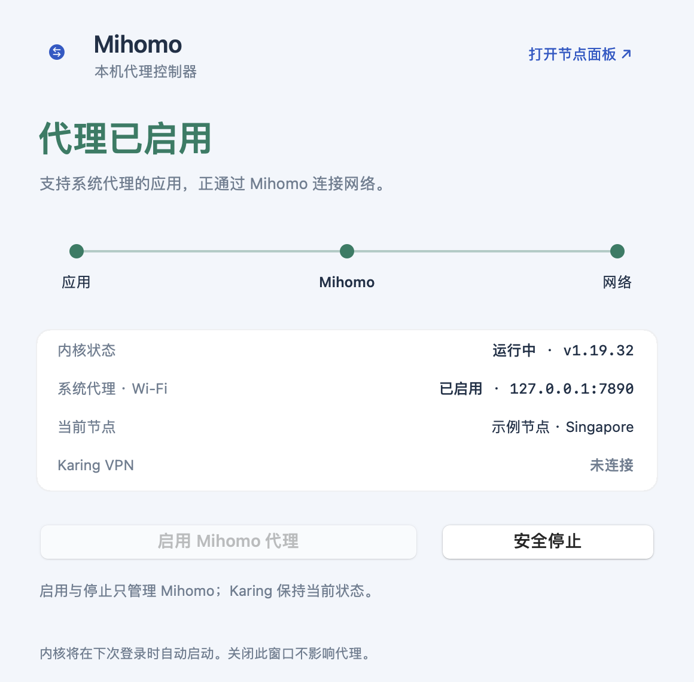

<p align="center">
  
</p>

# Mihomo 控制器

一个轻量的原生 macOS 小工具，用于查看 Mihomo 的运行状态、启用系统代理，以及按顺序安全停止代理和内核。使用 Swift + AppKit 开发，不需要 Node.js、网页服务器或第三方运行时。



截图使用虚构节点名称，不包含真实订阅或账号信息。

## 功能

- 显示内核、实际代理端口、Wi-Fi 系统代理和当前节点的状态。
- 启用时先等待内核及代理端口就绪，再打开 HTTP、HTTPS、SOCKS 系统代理。
- 停止时先关闭指向 Mihomo 的系统代理，再卸载内核的 LaunchAgent。
- 系统代理关闭失败时，保留内核运行，避免应用仍指向已关闭的端口。
- 启用失败时尝试恢复原有系统代理；不关闭其他客户端占用的代理地址和端口。
- 提供菜单栏快捷操作和本地节点面板入口。
- 只读取 Karing VPN 的连接状态，不负责启停它。

## 使用前提

本项目是**现有 Mihomo 安装的控制器**，不捆绑内核、代理节点或订阅管理功能，与上游 Mihomo 项目无隶属关系。

| 项目 | 当前约定 |
| --- | --- |
| 系统 | macOS 14 或更高版本 |
| 网络服务 | `Wi-Fi` |
| HTTP / SOCKS 混合端口 | `127.0.0.1:7890` |
| 本地控制 API | `http://127.0.0.1:9090`，当前版本不支持 API secret |
| 分组名称 | `PROXY`，用于显示所选节点 |
| LaunchAgent 标签 | `com.mihomo.proxy` |
| LaunchAgent 文件 | `~/Library/LaunchAgents/com.mihomo.proxy.plist` |

修改网络服务名称、代理端口或 API 地址时，需要同步修改源码。若系统要求管理员授权，工具会报告命令失败，不会自动提权。

### 1. 准备内核和配置

先自行安装 [Mihomo](https://github.com/MetaCubeX/mihomo)，并在仓库以外配置代理节点。控制器要求配置中包含：

```yaml
mixed-port: 7890
allow-lan: false
external-controller: 127.0.0.1:9090
profile:
  store-selected: true
```

这只是接口约定，不是一份完整的可联网配置。不要将自己的订阅、节点密码或完整配置提交到本仓库。

如已有 `com.mihomo.proxy` 服务，直接使用即可。若尚未创建，可显式运行：

```bash
python3 scripts/configure_launch_agent.py \
  --binary "$(command -v mihomo)" \
  --config-dir "$HOME/.config/mihomo" \
  --load
```

此脚本只在本机创建用户级服务，不会覆盖已有服务，也不会下载或修改订阅。`RunAtLoad` 与 `KeepAlive` 会让内核在登录时启动，并在异常退出后重新拉起。

### 2. 构建并打开

需要 Apple Command Line Tools（或 Xcode）和 Python 3，不需要额外 Python 包。

```bash
xcode-select --install  # 已安装开发工具时跳过
git clone https://github.com/zxhdaniel/mihomo-controller.git
cd mihomo-controller
python3 scripts/build.py --test
open "dist/Mihomo 控制器.app"
```

可以将生成的应用复制到自己的 Applications 文件夹；替换已有版本前，先退出控制器界面。构建产物位于 `dist/`，包含当前 CPU 架构的 `.app` 和 ZIP 包。应用使用本地 ad-hoc 签名，尚未进行 Apple Developer ID 签名或公证；Apple Silicon 与 Intel 需要分别构建。

构建脚本对旧版 Command Line Tools 的重复模块定义使用项目内 VFS overlay 兼容处理，不修改系统开发工具文件。也可以通过 `--sdk` 显式指定 SDK。

### 3. 日常操作

- **启用 Mihomo 代理**：启动内核，确认端口可用，再开启 Wi-Fi 系统代理。
- **安全停止**：先关闭属于 Mihomo 的系统代理，再停止内核。
- **打开节点面板**：打开已有的本地面板。面板需要在 Mihomo 中另行配置。
- **关闭窗口 / 退出控制器**：只退出界面，不会停止独立运行的内核。要关闭代理，请点击“安全停止”。

“安全停止”仅停止当前登录会话中的服务；原有的登录自启动设置保留，下次登录仍可能自动启动。

系统代理不是所有软件的必经通道。支持系统代理的应用会使用它，忽略系统代理或自行管理网络连接的软件可能绕过它。本工具不配置 TUN。

## 开发与验证

```bash
# 编译、运行模拟测试、生成不含真实节点的预览
python3 scripts/build.py --test --preview

# 仅读取本机状态，不修改网络设置
.build/MihomoController --status-json
```

测试覆盖启停顺序、启动失败后的回滚、系统代理关闭失败时保留内核，以及保留其他客户端的代理。测试使用 `FakeMachine`，不会切断真实网络。`--status-json` 的输出可能包含本机当前节点名称，请勿不经检查直接粘贴到公开 Issue。

```text
Sources/                 原生界面与控制逻辑
Tests/EngineTests.swift   不操作真实网络的行为测试
Assets/                  已选定的流线 M 图标
scripts/                 构建与可选服务配置脚本
docs/PRIVACY.md           数据范围和提交注意事项
```

## 隐私

应用只请求本机 API，不上传代理配置，不包含遥测，也不保存订阅链接。仓库不包含个人配置、节点凭据、运行日志或缓存。详见 [隐私说明](docs/PRIVACY.md)。

## 许可证

[MIT](LICENSE)。Mihomo 内核不随本项目分发，其许可证以[上游仓库](https://github.com/MetaCubeX/mihomo)为准。应用图标由 AI 辅助生成。
